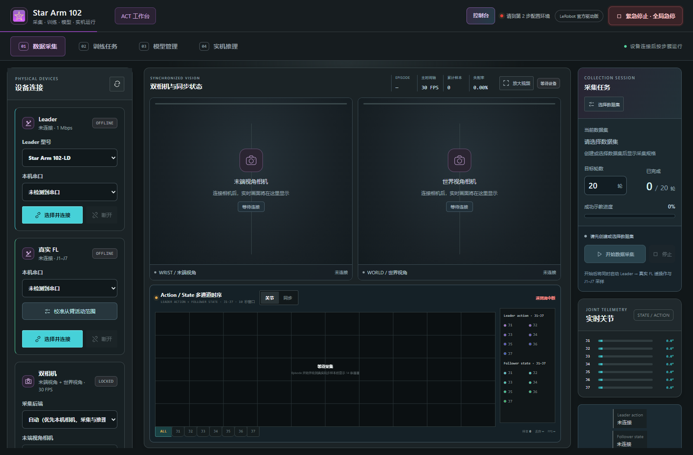
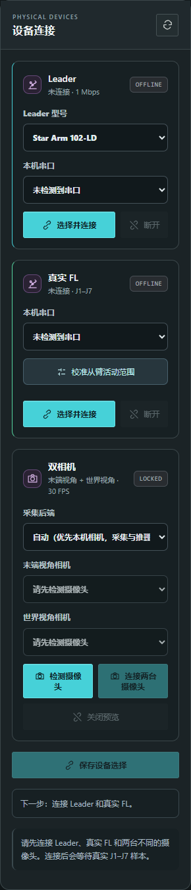
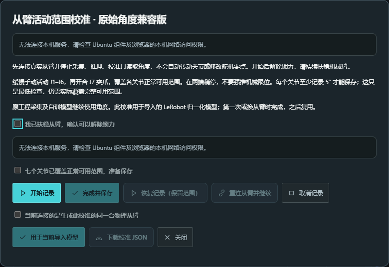
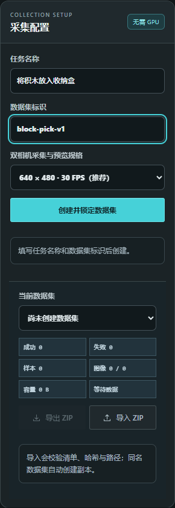
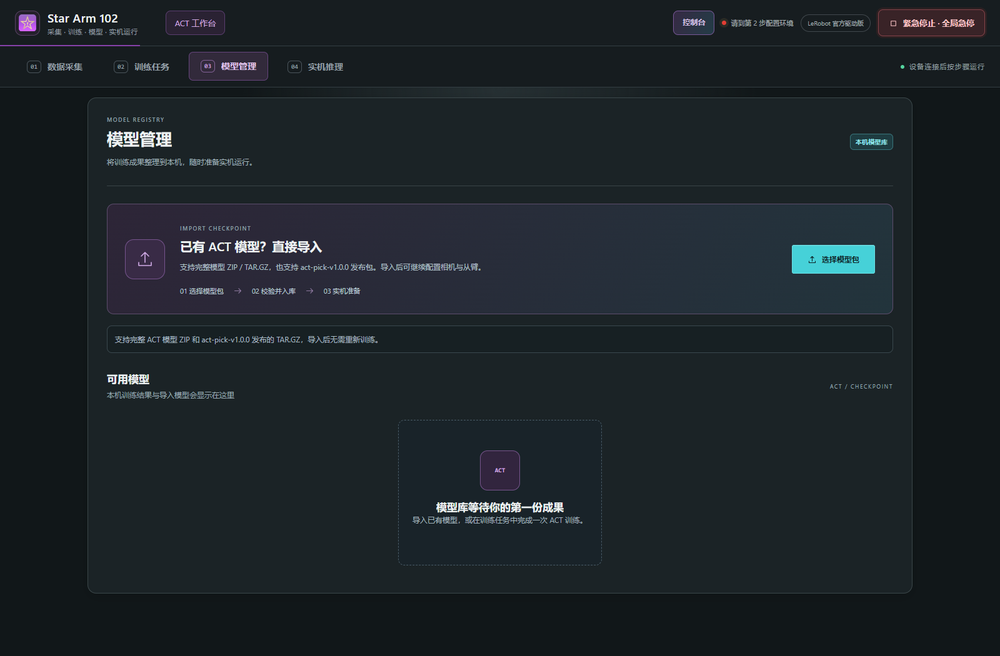
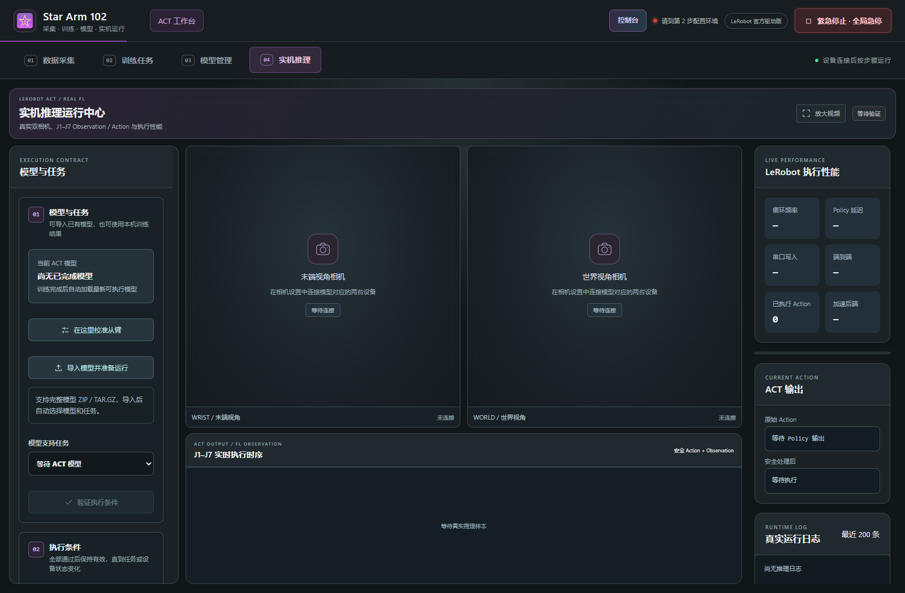
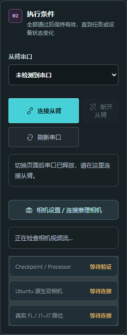

# ACT 工作台 · 采集、训练、导入与执行图文教程

**训练使用 Ubuntu 22.04 / 24.04；训练好的完整模型也支持 Windows 本机执行。**先按 [Ubuntu 教程](UBUNTU.md) 启动本机服务或安装网页提供的组件。Windows 启动、环境准备和模型执行步骤见 [Windows 教程](WINDOWS.md)。

截图来自当前真实网页的未连接状态，用于定位按钮和区域；没有模拟相机视频、训练结果或机械臂运动。校准截图中的“无法连接本机服务”是截图环境的离线提示，实际使用应先连接本机后台。

## 选择操作路线

| 目标 | 顺序 |
| --- | --- |
| 使用已有模型 | 第 2 步准备对应系统的运行环境 → 第 3 步导入模型 → 第 4 步连接设备、校验、执行 |
| 采集自己的数据并训练 | 第 2 步准备环境 → 第 1 步采集与审核 → 第 2 步训练 → 第 3 / 4 步管理与执行 |

只运行已有模型不需要先创建数据集、重新训练或连接 Leader。下面按页面分别说明。

## 第 1 步：数据采集

### 1.1 找到设备、视频和记录区域



| 区域 | 内容 |
| --- | --- |
| 左侧栏 | 主从臂、双相机、从臂校准、创建和选择数据集 |
| 中间上方 | 双相机画面、轮次、累计样本、同步状态 |
| 中间下方 | Action / State 多通道时序，观察目标与实际状态 |
| 记录区域 | 目标采集轮数、当前进度、开始 / 停止和轮次审核 |

左侧内容较多时在左侧栏内滚动。需要检查画面细节时点击 **放大视频**，用 **返回工作台 / Esc** 回到完整工作区。

### 1.2 连接 Leader 与真实 FL



1. 打开连接机械臂的 Ubuntu 电脑上的网页，确认本机服务已连接。
2. 在 **Leader 型号**选择实际主臂型号。
3. 选择 Leader 的 **本机串口**，点击 **选择并连接**。
4. 在 **真实 FL**卡片选择从臂串口，点击该卡片的 **选择并连接**。
5. 确认两台不同设备使用各自端口，并等待真实 J1–J7 数据。端口为空时先点击设备面板的重新检测按钮。

如果本机服务尚未连接，先完成第 2 步环境准备。其他控制程序可能占用端口；结束其连接后再在网页连接。

### 1.3 什么时候需要从臂范围校准

本工程原来的采集与自训练流程使用角度。**导入的 LeRobot 模型使用归一化坐标时，需要匹配的从臂校准 JSON**，不能把归一化值直接当角度发送。

已有原版 LeRobot 验证过的模型时，优先使用当时同一台物理从臂的校准文件。没有匹配文件、首次使用归一化模型或更换了物理从臂时，再进行范围校准。不是每次采集或启动都重新校准。



新建校准的操作：

1. 连接真实从臂，停止采集与推理，点击 **校准从臂活动范围**。
2. 扶稳机械臂，确认允许解除锁力，再勾选窗口中的确认项。**开始记录会解除锁力**，校准只读取角度，不自动带动关节。
3. 点击 **开始记录**。
4. 缓慢移动 J1–J6，再开合 J7 夹爪，覆盖各关节正常可用范围。在两端稍作停留，不要强推机械限位。
5. 查看记录反馈。每个关节至少 5° 只是最低保存检查；仍应覆盖模型实际工作需要的完整范围。
6. 勾选“七个关节已覆盖正常可用范围”，点击 **完成并保存**。
7. 要给当前归一化导入模型使用时，确认当前连接的是生成此校准的同一台物理从臂，点击 **用于当前导入模型**。
8. 使用 **下载校准 JSON**保留备份，之后按模型执行页的校准入口选择。

临时读取失败时页面会保留已记录范围并重试。不要为了消除错误把角度截断到 ±180°，也不要猜测转换关系；应检查端口、数据来源和真实反馈。需要离开时先完成保存或 **取消记录**，再关闭窗口或切换步骤。

### 1.4 连接双相机，确认角色一致

1. 在 **采集后端**选择“自动”或“本机原生”；完整 ACT 原生执行需要 本机相机流。
2. 点击 **检测摄像头**，等待设备列表更新。
3. 给两路角色选择两台不同的物理相机，点击 **连接两台摄像头**。
4. 检查两块预览是否实时更新，而不是只看 USB 是否插入。
5. 根据页面提示点击 **保存设备选择**，检查采集门槛是否通过。

**ACT 步骤之间切换会保留双相机连接和设备角色。** 第 1 步与第 4 步共用预览，不用每次重新检测或连接；第 2、3 步隐藏视频，返回后恢复。点击关闭相机或切换到控制台时释放相机连接。刷新或关闭网页会结束浏览器预览，本机原生相机以后台状态为准。串口仍会在步骤切换时释放。

“自动”在检测到两台本机原生相机时优先选原生，否则使用浏览器。浏览器预览也会在第 4 步显示，并标注“尚未接入推理”；**仅显示画面不代表满足 ACT 执行条件**。执行模型前，在第 2 步准备好本机环境，关闭当前相机后选择“本机原生”，重新检测并连接。

相机角色由模型特征配置决定。当前支持的映射会使用以下显示名称：

| 特征角色 | 对应视角 |
| --- | --- |
| `wrist` | 末端视角 |
| `world` | 世界视角，具体机位以模型训练时为准，不能一概当作俯视 |
| `up` | 固定俯视 |
| `front` | 固定正面 |

你使用的 [act-pick-v1.0.0 发布模型](https://github.com/servodevelop/Star-Arm-102/releases/tag/act-pick-v1.0.0) 使用 **固定俯视 UP + 固定正面 FRONT**，应按这两路固定机位配置，不用随臂运动的腕部相机。其他模型可能使用 `wrist + world`。导入模型后标签会按映射更新；采集和推理都按**模型定义、当前标签和实际画面**对应，不能按 USB 插入顺序猜相机。更换相机位置、角色或分辨率后，要重新检查与训练条件是否一致。

### 1.5 创建数据集



在左侧 **采集配置**填写：

| 项目 | 示例 | 要求 |
| --- | --- | --- |
| 任务名称 | 将积木放入收纳盒 | 描述实际任务，可以使用中文 |
| 数据集标识 | `block-pick-v1` | 3–48 位小写字母、数字、连字符；首位为字母或数字，不能重复 |
| 双相机采集与预览规格 | 640 × 480 · 30 FPS | 页面推荐规格；已有模型仍需按模型要求配置 |

1. 填完后点击 **创建并锁定数据集**。
2. 查看按钮下方提示：校验或创建失败会在这里显示原因。
3. 创建成功后，**当前数据集**应自动选择新数据集，列表中出现任务名称与标识。
4. 若使用已有数据集，在 **当前数据集**下拉框选择即可。

点击失败后先看提示：标识格式错误、同名、服务未连接分别需要不同处理。请求超时可能表示结果尚未确认，先刷新列表检查是否已创建，避免重复提交。

### 1.6 逐轮示教与审核

1. 确认设备门槛通过、当前数据集正确，设置 **目标采集轮数**。轮数代表要记录多少次任务，不是训练 Step。
2. 点击 **开始数据采集**，完成一次实际示教，观察双相机与 Action / State 曲线是否持续更新。
3. 一轮结束后点击停止按钮，等待关节和相机数据收尾，不要在保存过程中拔掉设备。
4. 在审核区域检查样本、图像数量、同步质量及任务结果，再按页面按钮标记成功、失败或删除。
5. 审核后再开始下一轮。目标进度按页面实际已审核轮次显示，不会因为点击开始就算完成一轮。

没有有效关节样本或相机帧时应先修复设备，不能把空记录当成功示教。训练会检查数据完整性，成功标签也不能替代完整性检查。

数据集面板的 **导出 ZIP**用于备份完整数据，**导入 ZIP**会校验清单、哈希与路径，同名数据集创建副本。单独复制一段视频不是完整数据集导入。

## 第 2 步：训练任务与环境准备

### 2.1 首次使用服务器网页


1. 在连接设备的 Ubuntu 电脑上打开提供方网站，到 **训练任务**。
2. 若本机组件未安装，点击 **下载 Ubuntu 安装文件**。网页自动将当前网站地址写入安装包，不用填写发布配置。
3. 在 Ubuntu 的系统安装器打开 `.deb`，点击安装并按系统要求授权。
4. 回到**下载该组件的同一网站**，按浏览器提示允许本机网络访问。网页检测到后台后继续准备环境。
5. 观察页面环境进度与状态；如果页面仍等待，可使用 **检查并自动配置环境**或环境面板的 **自动配置环境**按钮。

**只下载文件不会完成系统安装。** 系统安装授权是首次操作；之后组件会尝试在桌面用户下运行，并设置登录自启动。使用源码启动方式时已自带后台，不必再同时安装组件占用同一端口。

环境是独立 **Python 虚拟环境**，不是 Docker。PyTorch / LeRobot 的下载和检查在本机完成，第一次可能较久。失败时查看页面错误，处理网络、磁盘或系统依赖后点击 **重试准备**；已就绪环境会复用。

只执行已有模型也需要环境，但不需要点击开始训练。系统 GPU 驱动是否可用以自检结果为准，网页依赖安装不能代替所有系统驱动准备。

Windows 源码方式在第 2 步准备执行环境，支持 NVIDIA CUDA / CPU，训练表单会隐藏；继续第 3、4 步执行。不要在 Windows 安装 Ubuntu `.deb`。详见 [Windows 操作流程](WINDOWS.md)。

### 2.2 配置训练参数（Ubuntu）

环境就绪后出现数据集选择和训练参数：

| 参数 | 含义 | 怎么选 |
| --- | --- | --- |
| 训练数据集 | 当前本机已导入或采集的数据 | 确认任务和已审核轮次正确 |
| Batch | 每次更新处理的样本数量 | 结合显存与实际训练情况设置，内存不足时减小 |
| 目标 Step | 训练器更新次数 | 不是采集轮数；按任务与数据规模设置 |
| 保存间隔 | 每多少 Step 保存 Checkpoint | 应与目标 Step 配合，留出可恢复的保存点 |

页面默认值是起始配置，不是所有模型、GPU和任务的通用最优参数。设置完成后点击 **开始训练**。

### 2.3 查看真实进度，停止和恢复

训练面板显示状态、Step、Loss、运行时间、Checkpoint 时间线和实时日志。启动阶段可能还没有 Loss；日志开始输出真实指标后曲线才会出现。

- **停止训练**：请求结束当前任务，等待状态实际更新。
- **从 Checkpoint 恢复**：有可恢复的真实保存点时按页面入口继续；没有保存点不能凭空恢复。
- **训练启动失败**：查看失败阶段和日志，先修复数据、依赖或显存问题，再启动。

训练在客户电脑进行，数据和权重不上传到静态网站服务器。不要仅根据进度条判断模型能完成任务，训练完成后仍需执行验证。

## 第 3 步：模型管理

### 3.1 导入已有模型



1. 点击 **选择模型包**。
2. 选择完整 ZIP、TAR、TAR.GZ 或 TGZ 模型包；网页导入文件上限为 2 GB。
3. 等待上传、解包、配置与文件校验完成，查看页面结果。
4. 成功后模型应出现在 **可用模型**列表，点击 **用于推理**启用模型，或 **导出模型**备份。

导入不会自动启动真实机械臂，也不需要重新训练。第 4 步的 **导入模型并准备运行**也可进入导入流程。

### 3.2 完整模型包应包含什么

本工作台导出的包含模型元信息和 `pretrained_model`；典型结构如下，处理器引用的状态文件也必须一起带上：

```text
model.json
pretrained_model/
  config.json
  model.safetensors
  policy_preprocessor.json
  policy_postprocessor.json
  ...处理器配置引用的 state_file 文件
```

支持的上游发行包可以根据其模型配置与目录识别元信息，**并非所有受支持的包都必须手写 `model.json`**。不要添加空 `model.json` 来绕过检查；仅一个 `.safetensors` 权重文件也不能执行。

导入失败时记录完整提示，确认下载的是完整模型资产，而不是源码、校准 JSON 或单独权重。如果压缩包内混入多个模型元信息文件，应重新整理为一个完整模型的包。

## 第 4 步：实机推理

### 4.1 选模型并在本页连接从臂



**切换 ACT 步骤会释放串口。** 即使刚在第 1 步连接过，进入第 4 步也要重新连接；只执行模型不需要 Leader。



1. 检查第 4 步显示的 **当前 ACT 模型**。需要换模型时，到第 3 步对目标模型点击 **用于推理**，返回后重新连接从臂。
2. 在 **从臂串口**下拉框选择当前物理从臂端口；列表为空先点 **刷新串口**。
3. 点击 **连接从臂**，等到状态确认成功并取得真实关节反馈。
4. 对于归一化模型，导入并确认同一台物理从臂的校准 JSON；角度模型按自身配置执行，不随意套用另一台臂的校准。
5. 检查两路本机原生相机已连接，并且角色、画面与模型一致。

需要配置相机时使用 **相机设置 / 连接推理相机**入口返回第 1 步。完成相机设置后返回第 4 步，双相机预览会继续显示；**再次在第 4 步连接从臂**，因为步骤切换已经释放串口。

### 4.2 完成校验再启动

点击 **验证执行条件**，按页面提示完成运行校验。通常需要确认：

- 模型、处理器文件和隔离运行环境完整且可用。
- 从臂实际连接、关节反馈有效，校准与模型坐标一致。
- 本机原生双相机可用，特征角色和输入规格匹配模型。
- 当前工作区已按页面要求确认。

门槛通过后，点击 **启动真实 FL 低速推理**。运行中查看双相机、Action / State 曲线、实际动作和诊断指标。停止时点击 **停止推理并立即卸力**；需要立即终止当前控制时使用顶部 **紧急停止 · 全局急停**。

### 4.3 怎么判断运行是否正常

| 指标 | 看什么 |
| --- | --- |
| 目标频率 / 循环频率 | 实际节拍是否接近目标，是否出现持续掉速 |
| Policy 延迟 / 端到端 | 策略计算和整个执行链路的耗时 |
| 已执行 Action / 剩余动作 | 动作队列与调度是否在推进 |
| 模型请求移动 / 机械臂实际移动 | 目标有变化时，真实反馈是否也变化 |
| 指令跟随误差 | 目标与真实反馈的偏差是否持续扩大 |
| 加速后端 | 使用的是自检确认的实际计算设备 |

**锁力只说明机械臂处于保持状态，不证明动作已正确写入。** 如果模型请求明显移动而实际反馈几乎不变，先停止，检查当前从臂端口、校准、关节映射及串口写入。不要靠增大动作幅度尝试掩盖问题。

## 结束本次操作

1. 结束并审核采集轮次，确认需要保存的数据已保留。
2. 确认训练已完成或按需要停止，导出需要备份的模型与数据集。
3. 停止推理，再断开设备或离开页面；校准窗口先保存或取消。
4. 按 [常见问题](TROUBLESHOOTING.md) 处理错误，并保留完整提示与训练日志。

实际 Ubuntu 安装、相机、GPU 和机械臂效果应在目标电脑验收；这些界面截图不替代实机测试。
