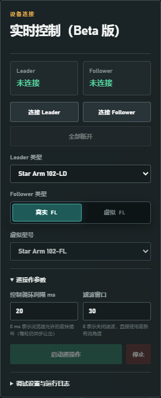
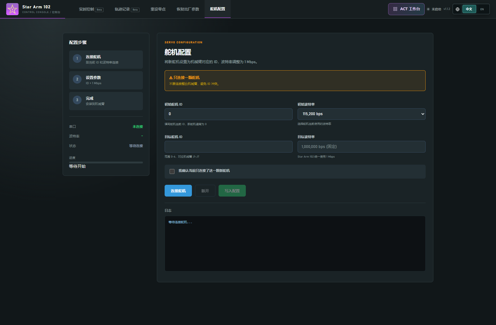

# Star Arm 102 控制台 · 图文操作教程

控制台用于连接设备、查看三维姿态、主从控制、关节和末端目标操作，以及舵机设置。完整 ACT 流程另见 [ACT 图文教程](ACT_GUIDE.md)。本文截图均为实际网页的未连接状态。

## 1. 打开网页并认识界面

服务器方式直接访问提供方网站；源码方式按 [Ubuntu](UBUNTU.md) 或 [Windows](WINDOWS.md) 教程启动。推荐在桌面 Chrome / Edge 中使用。

左侧是设备和控制入口，中间是三维视图，右侧是参数与目标。先完成设备连接，再使用对应的真实控制按钮。三维模型本身可在未连接设备时显示。

## 2. 分别连接主臂和从臂

1. 将机械臂接到当前电脑，确认供电和 USB 线正常。
2. 在左侧选择实际使用的主臂类型。PiPER Mate 是支持的硬件类型之一；姿态来源的显示与可用控制以当前选择的硬件为准。
3. 点击主臂对应的连接按钮，在浏览器弹出的串口列表中选择主臂端口。
4. 选择从臂类型。使用真实机械臂时选择真实设备；虚拟从臂用于界面预览，不能驱动真实电机。
5. 点击从臂连接按钮，选择从臂端口。两台不同设备不能误选同一个端口。
6. 检查连接状态，并确认实际关节值能够更新。没有反馈时先处理设备连接，不要仅根据三维模型判断已连接。

浏览器串口选择必须由用户点击触发；服务器网站应使用 HTTPS。若没有设备列表，检查浏览器是否支持 Web Serial、系统权限和端口是否被其他软件占用。参见 [Chrome 官方串口说明](https://developer.chrome.com/docs/capabilities/serial)。

## 3. 调整三维视角

使用鼠标拖动旋转、滚轮缩放，以及界面提供的默认视角、适应画面或全屏按钮查看机械臂。三维目标预览用于检查姿态；实际机械臂有没有跟随，需要结合真实反馈和现场观察。

页面隐藏或机械臂静止时会减少重复绘制；拖动、姿态变化和切换动画仍正常显示。浏览器缩放建议先恢复到 100%，小屏幕可收起浏览器侧栏或使用全屏。

## 4. 主从控制

1. 确认主臂和真实从臂均已连接，且两者数据正常。
2. 检查主从型号、关节对应和目标参数是否符合当前硬件。
3. 使用页面的主从控制启动按钮，先进行小范围操作并观察实际反馈。
4. 结束时使用停止按钮。切换页面也会先停止控制并释放串口。

控制参数需依据实际硬件与任务设置，不建议直接照搬其他型号的速度或关节范围。若主臂状态变化、从臂却不动，停止控制后检查从臂连接、关节映射和指令反馈。

## 5. 关节目标与末端目标

在对应控制面板中查看当前值、输入或拖动目标，先检查三维预览，再按页面按钮执行。关节目标与末端目标使用各自的控制入口；不要同时开启多个控制来源。

真实运动需要真实从臂连接及页面校验通过。虚拟模式中的姿态变化只是预览。执行后观察实际关节值与目标的差异；若没有跟随，停止并处理连接或驱动问题。

## 6. 轨迹管理

控制台轨迹功能用于记录、编辑、预览和播放从臂轨迹。导入或编辑后先检查轨迹与所选硬件匹配，再播放；结束时停止。

**控制台轨迹文件不是完整 ACT 数据集。** ACT 训练需要在 ACT 第 1 步记录同步的关节和双相机数据，并审核轮次；不能把只有关节目标的轨迹文件当成示教数据集。

## 7. 舵机设置与原点操作

舵机设置用于维护设备 ID、通信参数等。先读取当前参数，再选择需要修改的目标，按页面提示写入并验证。修改 ID 时应按提示连接目标舵机，避免总线上多台设备响应同一个 ID。

原点重置、工厂恢复和 ACT 从臂范围校准用途不同。正常采集或训练不要求每次重新设置舵机 ID、恢复工厂参数或重置原点。只有设备配置确实需要维护时才使用这些入口。

## 8. 去 ACT 或返回控制台

点击 ACT 入口后会先结束当前控制并释放串口，显示约 5 秒全屏切换画面。ACT 顶部的 **控制台** 按钮可返回。

返回后的设备需要在目标页面重新连接。页面切换提示设备释放失败时，先处理提示；若仍有未保存的校准或待审核记录，先按页面要求完成。

下一步：[ACT 图文教程](ACT_GUIDE.md) · [常见问题](TROUBLESHOOTING.md)
