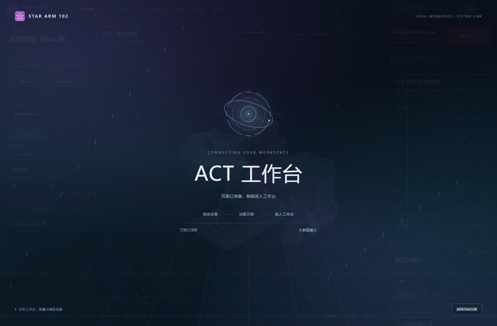

# Star Arm 102 数字孪生平台 · 图文快速上手

平台有两个工作区：**Star Arm 102 控制台**用于连接设备、三维查看和控制；**ACT 工作台**用于采集、训练、管理模型和实机推理。先按自己的用途选择入口，再按对应教程操作。

本文及配套教程的截图来自当前实际网页，采用**未连接硬件、未启动训练**的状态。截图中的空相机、空模型库和连接提示用于说明位置，不代表已完成实机验证。点击图片可以查看原图。

## 1. 先选对使用方式

| 你的用途 | 获取什么 | 下一步 |
| --- | --- | --- |
| 客户通过提供方网站使用 ACT | 打开提供方的 HTTPS 网站，不必下载源码 | 用 Ubuntu，进入 ACT 第 2 步，按 [Ubuntu 首次使用教程](UBUNTU.md) 安装网页提供的运行组件 |
| 运营者把网站上传到服务器 | [最新 Release](https://github.com/VincentHSS/Star-Arm-102-Web-ACT/releases/latest) 的 `Star-Arm-102-SERVER-UPLOAD-ONLY.zip` | 只上传其中 `服务器网页` 里的内容，按 [服务器发布教程](DEPLOYMENT.md) 验收 |
| 在 Ubuntu 本机运行整个项目 | GitHub 首页 **Code → Download ZIP** 的源码 | 解压后运行根目录 `start_ubuntu.sh`，详见 [Ubuntu 本地启动](UBUNTU.md) |
| 在 Windows 本机控制设备、执行已有模型 | 同上，下载源码 | 解压后双击根目录 `start_windows.bat`，详见 [Windows 教程](WINDOWS.md) |

**ACT 训练使用 Ubuntu，完整模型可以在 Windows 或 Ubuntu 执行。Windows 运行步骤见 [Windows 教程](WINDOWS.md)。** 网站服务器只存放网页；机械臂、相机、数据、模型和 GPU 都在客户电脑上。服务器交付包中没有源码启动脚本，找不到 `start_ubuntu.sh` 时先检查下载的是否为源码。

## 2. 认识控制台

| 区域 | 做什么 |
| --- | --- |
| 左侧设备面板 | 选择主臂、从臂类型，分别连接串口，查看设备状态 |
| 中间机械臂画面 | 查看三维姿态，旋转、缩放视角，预览目标 |
| 右侧控制面板 | 查看关节值、设置目标、开始或停止对应控制 |
| 顶部导航 | 切换控制台子页面、进入 ACT 工作台 |

三维机械臂能够显示，不等于真实机械臂已经连接。连接是否成功要看设备面板状态以及读取到的实际关节数据。详细按钮用法见 [控制台图文教程](CONSOLE_GUIDE.md)。

## 3. 进入 ACT 工作台

点击控制台的 ACT 入口。切换时会显示全屏启动动画，正常约 5 秒后进入另一工作区；即使页面提前就绪，动画也会保留完整显示时间。

ACT 顶部的四个步骤分别是：

| 步骤 | 页面名称 | 主要用途 |
| --- | --- | --- |
| 1 | 数据采集 | 连接设备、校准、双相机预览、创建数据集、记录和审核示教轮次 |
| 2 | 训练任务 | 首次准备本机环境，选择数据集，开始、停止或恢复训练 |
| 3 | 模型管理 | 导入已有完整 ACT 模型包，查看本机训练结果，导出模型 |
| 4 | 实机推理 | 选择模型，连接从臂和原生双相机，校验后执行 |

## 4. 按目标走一条完整流程

### 已经有训练好的模型

1. 在 Ubuntu 打开网页，或在 Windows 用源码启动脚本打开本机网页，进入 **第 2 步**，完成首次运行组件安装和环境准备；已有就绪环境可以复用。
2. 进入 **第 3 步**，点击 **选择模型包**，导入包含权重、配置和处理器文件的完整模型包。单独权重文件不能代替完整包。
3. 进入 **第 4 步**，选择模型，并在该页重新连接从臂。
4. 按模型要求准备同一台从臂的校准 JSON，连接对应角色的双相机。
5. 完成页面校验，确认工作区条件，再点击启动推理。

此流程不要求先录制新数据或重新训练；只执行已有模型也不要求连接主臂。详细操作见 [ACT 教程的模型导入与执行部分](ACT_GUIDE.md)。

### 需要采集自己的数据并训练

1. 先在 **第 2 步**完成本机服务和训练环境准备。
2. 到 **第 1 步**连接主从臂、设置双相机，创建数据集。
3. 逐轮记录示教；每轮停止后检查质量，再标记成功、失败或删除。
4. 到 **第 2 步**选择已审核的数据集，配置训练参数并开始训练。
5. 训练产出的完整模型会进入 **第 3 步**；到 **第 4 步**重新连接从臂，完成执行校验。

## 5. 切换页面时会发生什么

控制台子页面与 ACT 步骤切换会先停止当前控制、释放串口，再进入目标页面。**不要把上一页的“已连接”当作下一页仍然连接。** 进入第 4 步后，请直接在第 4 步连接从臂。

ACT 各步骤之间保留相机连接和角色，第 1、4 步共用实时预览；第 2、3 步隐藏视频。切换回控制台或点击关闭相机时释放相机。刷新或关闭网页会结束浏览器预览，本机原生相机以后台状态为准。自动后端若使用浏览器，画面可显示，但执行模型仍需本机原生双相机。

记录中的轮次会先结束并保留待审核内容；正在校准时，应先保存或取消校准，再切换。若设备释放失败，网页会提示原因并保留当前页面。训练任务不依赖持续连接的机械臂串口，任务是否结束以训练状态为准。

## 6. 遇到问题先看这里

| 现象 | 先检查 |
| --- | --- |
| 下载了 Ubuntu 文件，但网页仍说未连接 | 下载不等于安装；用系统安装器完成安装和授权，再返回原网站 |
| 第 4 步说从臂未连接 | 页面切换会释放串口，在第 4 步重新选择端口并连接 |
| USB 相机已经插上，仍说原生相机未连接 | 确认当前电脑后台已连接，并在网页选择设备、打开原生相机流 |
| 模型导入提示缺少文件 | 使用完整模型包，不要只选权重，也不要创建空 `model.json` |
| 机械臂锁力了但没有运动 | 先停止执行，查看实际状态、写入和校准；锁力不等于已发送动作 |
| 按钮点了没有立即弹出 | 看按钮处理提示及下方状态，等待当前操作完成；超时后先核实结果再重试 |

更完整的说明见 [常见问题](TROUBLESHOOTING.md)。每个源码文件的作用见 [文件用途清单](FILE_MAP.md)。
