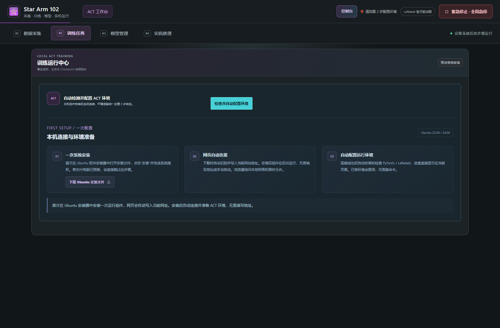
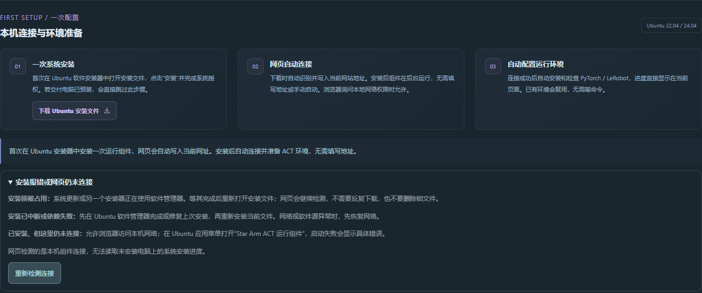

# Ubuntu · 首次使用与本地启动

适用 Ubuntu 22.04 / 24.04，Python 3.10～3.12，桌面 Chrome / Edge。完整 ACT 采集、训练及原生实机执行均使用 Ubuntu。

## 方式一：客户使用服务器网站

客户不需要下载源码，不用手填后台地址或训练命令。机械臂和相机连接客户当前 Ubuntu 电脑，服务器只托管网页。

### 第一次打开

1. 在设备所在电脑打开提供方的 HTTPS 网站。
2. 从控制台进入 ACT，点击顶部 **02 训练任务**。
3. 找到 **本机连接与环境准备**。如果电脑未安装组件，会出现下图的一次配置说明。



### 下载后怎样安装

1. 点击 **下载 Ubuntu 安装文件**，等待浏览器下载 `.deb` 文件。
2. 打开文件管理器的 **下载**文件夹，找到刚下载的 `star-arm-act_…_all.deb`。
3. 用支持 `.deb` 的 Ubuntu 软件安装器打开文件。不同桌面的名称和布局可能不同；若双击进入归档管理器，使用“打开方式”选择系统软件安装器。
4. 在安装器内点击 **安装**，按系统弹窗要求输入有权限的账号密码或授权。
5. 等待安装完成，再回到刚才下载文件的原网站。

**仅下载文件不等于安装成功。** 系统安装授权需用户首次完成，普通网页不能在完全没有本机组件时代替操作系统安装软件。本教程没有伪造 Ubuntu 安装器截图，实际安装界面以客户系统为准。

安装后组件会尝试在当前桌面用户下运行，并配置登录自启动。网页会检测后台；浏览器询问访问本机网络时允许。若安装成功但仍未连接，见 [常见问题](TROUBLESHOOTING.md)，必要时退出桌面并重新登录。

### 安装器提示 dpkg 前端锁被占用

这是 Ubuntu 更新或另一个安装程序占用软件管理器，发生在组件代码运行之前。普通网页无法改变系统安装器的等待行为。第 2 步展开 **安装报错或网页仍未连接** 可查看处理说明，点击 **重新检测连接** 会继续检测实际后台状态。



先等待系统更新完成，关闭原安装窗口后重新打开同一个 `.deb`；不用反复下载。若 `ps -p 报错PID -o pid,etime,comm,args` 只有表头，说明该 PID 已退出；重新安装若出现不同 PID，以新报错为准。**不要删除锁文件，也不要强制结束正在安装系统组件的进程。** 原因见 [Debian 官方说明](https://wiki.debian.org/Teams/Dpkg/FAQ#db-lock)。

系统安装器仍立即报告锁占用时，维护人员可以在“下载”目录使用 APT 的等待方式安装。文件名需对应实际下载文件：

```sh
sudo apt-get -o DPkg::Lock::Timeout=300 -o Acquire::Retries=3 --no-remove install ./star-arm-act_1.0.13_all.deb
```

使用源码的维护人员也可运行 `/usr/bin/python3 tools/ubuntu_setup.py --package /完整路径/组件.deb`，使用同样的等待和授权逻辑。以上是安装器报错时的替代方式，日常网页客户仍按系统安装器操作。

### 解包提示无法创建 Browser_SDK/index.html.dpkg-new

若同时提示“没有那个文件或目录”，请更新服务器网页，刷新后从原网站重新下载当前安装文件并安装。安装包应包含 `/opt/star-arm-act/Browser_SDK` 等父目录。

维护人员临时恢复旧包时，可先执行 `sudo mkdir -p /opt/star-arm-act/Browser_SDK`，再用上述 APT 命令安装实际下载的 `.deb`。若仍出现其他缺失目录，请使用当前安装包。无需删除原有模型、数据或系统锁文件。

### 自动准备环境

1. 本机连接成功后网页继续准备环境；需要重新检测时点击 **检查并自动配置环境**。
2. 在环境面板查看当前阶段、下载进度和检查结果。
3. 等待环境就绪；首次下载依赖可能较久，处理错误后可点击 **重试准备**。
4. 已有模型的客户接着进入第 3 步导入，不必开始训练；需要训练的客户先到第 1 步采集。

后台只监听当前电脑的 `127.0.0.1:18765`。网页下载组件时自动绑定当前网站的协议、域名和端口；更换网站地址后，应在新网站重新下载并安装。不要将本机后台开放到公网。

## 方式二：在 Ubuntu 上运行本地源码

源码方式适合项目维护、离线本地界面或没有服务器网站的情况。启动时检测 18765 上现有 ACT 后台并复用；不会结束它的设备操作，也不会偷偷改用另一份数据目录。旧版服务仍运行时，会提示先结束任务再正常重启。

### 下载和解压

1. 打开 [GitHub 仓库](https://github.com/VincentHSS/Star-Arm-102-Web-ACT)。
2. 点击绿色 **Code → Download ZIP**，等待源码下载。
3. 解压到自己的目录。文件夹名可能带 `-main`；打开后应能看到 `start_ubuntu.sh`、`start_windows.bat`、`Browser_SDK/` 和 `tools/`。
4. Release 的 `SERVER-UPLOAD-ONLY.zip` 是服务器静态包，没有这些启动脚本，不要混用。

### 首次准备系统依赖

直接运行下面的启动脚本即可。它会检查 venv、相机工具及系统库，只为缺失依赖调用 Ubuntu 安装授权；不要求先复制多条 apt 命令。dpkg 锁占用等待最多 5 分钟，下载失败由 APT 重试，超过等待时间会保留具体错误并停止启动，处理后重开即可。

不会删除系统锁、强杀系统更新、卸载软件或执行全系统升级。Ubuntu 的安装授权仍需用户完成；网页不能替代该系统权限。APT 管理说明见 [Ubuntu 官方文档](https://ubuntu.com/server/docs/how-to/software/package-management/)。

脚本使用 `/usr/bin/python3`，即使终端显示 `(base)` 也不会使用 Conda 的 Python。系统 Python 需在 3.10～3.12 范围内；Ubuntu 22.04 / 24.04 通常已具备。GPU 驱动由当前电脑预先具备，后续以网页自检为准。

### 启动网页

在源码根目录右键“在终端打开”，输入：

```sh
sh start_ubuntu.sh
```

启动脚本会打开 `http://127.0.0.1:18765/`。如果浏览器没有自动打开，手动访问该地址。看到完整控制台并能打开 ACT，说明网页入口已经正常；设备是否连接和环境是否就绪仍看页面状态。

不要双击后只用文本编辑器查看脚本；用上述方式运行也不要求预先给脚本设置可执行权限。当前脚本为 Linux LF 换行；遇到“第 2 行”或奇怪字符错误时，重新下载当前源码，避免使用旧的 CRLF shell 文件。

只启动服务、不自动打开浏览器：

```sh
sh start_ubuntu.sh --no-browser
```

如需指定状态目录：

```sh
sh start_ubuntu.sh --state-dir "$HOME/star-arm-data"
```

启动终端承载本地服务，应保持打开。结束记录、训练或推理后，在终端按 Ctrl+C 停止服务。

若系统软件源索引缺失、之前的系统安装中断或授权被取消，启动窗口会解释原因。先在 Ubuntu 软件管理器修复系统安装或刷新源，再重新运行启动脚本；不会自动对整个系统执行强制修复。

第 2 步依赖下载遇到连接重置、超时等暂时故障时，最多尝试 3 次，页面显示重试状态；依赖版本冲突等永久错误直接提示。环境准备时服务被关闭，重新启动后会显示“上次环境准备中断”，点击 **重试准备**；已有模型、数据集和已发布的运行环境不会因此删除。

## 环境、权限和数据位置

| 项目 | 说明 |
| --- | --- |
| ACT 环境 | 第 2 步准备独立 Python 虚拟环境，**不是 Docker**，不要求客户输入训练代码 |
| 加速设备 | NVIDIA CUDA、AMD ROCm、Intel XPU 是否可用取决于实际驱动和环境自检；不以截图或电脑型号代替结果 |
| 数据目录 | 默认 `~/.local/share/star-arm-act/`，设置了 `XDG_DATA_HOME` 时跟随该位置；网页可更改数据目录 |
| 组件日志 | 默认状态目录下的 `runtime.log` |
| 源码启动错误 | 查看启动终端；完整错误比“点了没反应”更容易定位 |
| 串口权限 | 组件有 udev 规则；源码方式可由管理员设置 `dialout` 访问权限，重新登录并重新插拔设备 |
| 相机角色 | 按模型特征与网页标签选择，不统一假设末端 + 俯视；详见 ACT 教程 |
| 校准文件 | 必须对应当前物理从臂以及模型坐标要求 |

数据、模型和校准保留在客户电脑。备份请使用网页导出入口，并妥善保留校准 JSON。

下一步：[ACT 图文教程](ACT_GUIDE.md) · [控制台教程](CONSOLE_GUIDE.md) · [常见问题](TROUBLESHOOTING.md)
