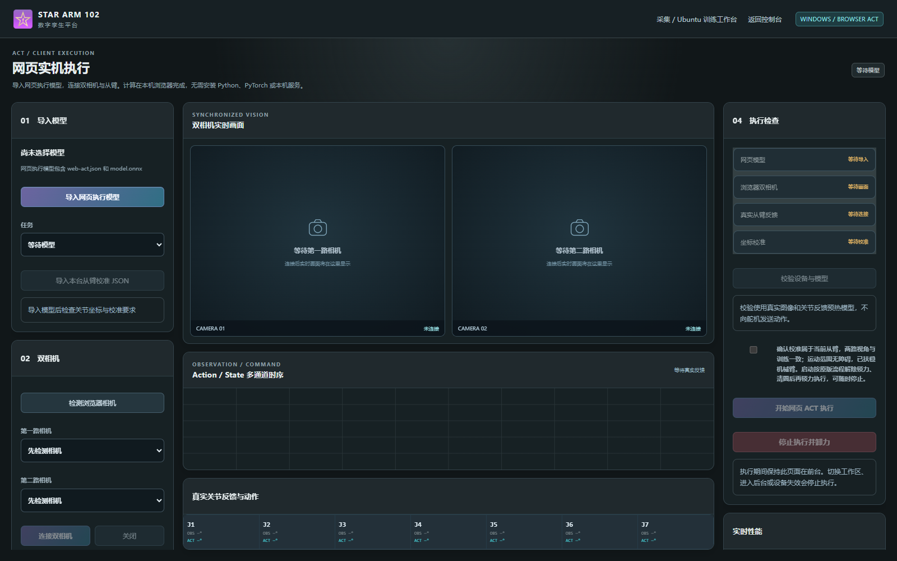
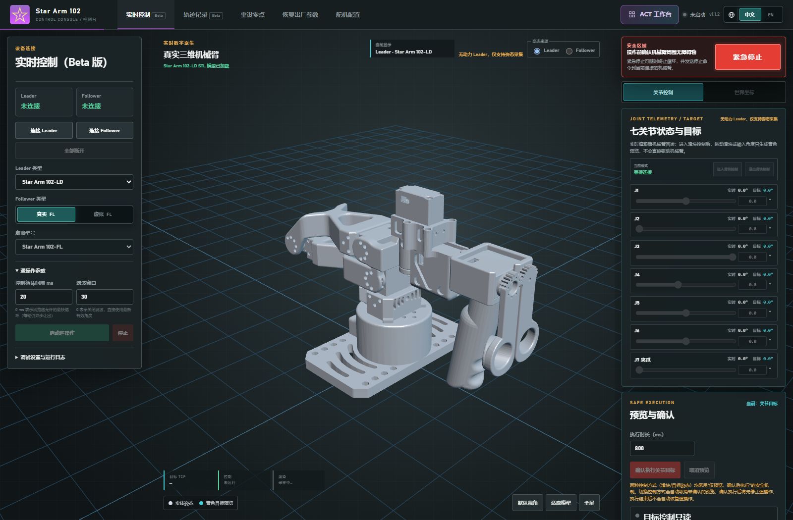
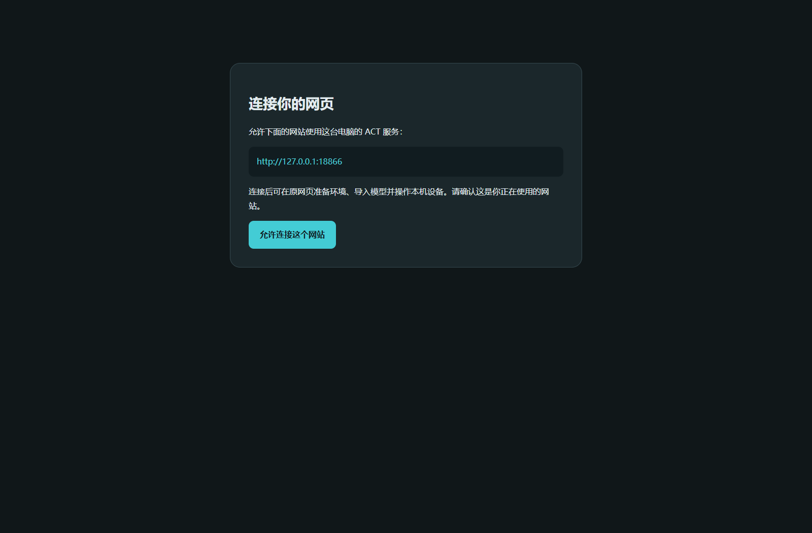
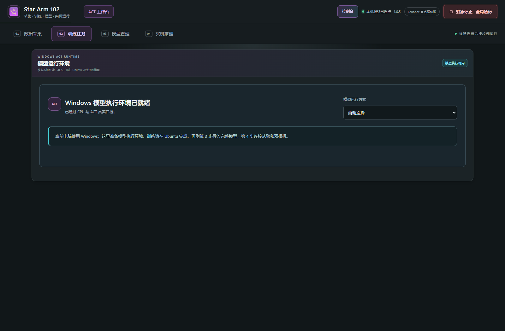

# Windows · 纯网页执行与可选本机服务

**客户推荐使用纯网页 ACT：打开 HTTPS 网站的 `act-browser.html`，导入网页执行模型，授权双相机、选择从臂串口，再校验执行。无需安装 Python、PyTorch、LeRobot 或本机服务。**完整步骤、模型格式和截图见 [Windows 纯网页执行教程](BROWSER_EXECUTION.md)。训练和恢复训练仍使用 Ubuntu。

从控制台点击 ACT 会先进入四步骤工作台；免安装执行可点顶栏 **网页执行**。需要采集时，在第 1 步配置本机设备服务，使用浏览器双相机即可采集，不必先完成第 2 步训练依赖安装。原生相机可以使用系统已安装的 FFmpeg；没有该工具时选择浏览器后端。

## 1. 客户直接使用服务器网页

从原工作台第 4 步点击 **Windows 网页直接执行**，或直接打开提供方发来的网页执行地址。模型必须是提供方转换好的网页包；普通 PyTorch checkpoint 不能直接由浏览器执行。浏览器引擎随网站加载，客户不需要下载 Ubuntu 组件或运行 `.bat`。

首次授权相机与串口后，按界面连接和校验。归一化模型仍使用本台从臂的校准参数。Chrome / Edge 需要可用的 WebGPU；显卡硬件加速关闭、USB 设备未被系统识别时，应先处理设备或浏览器设置。

## 2. 可选：使用源码和本机 LeRobot 服务

以下是另一条本机执行路线，供开发、模型管理或保留原 PyTorch 检查点的用户使用，**不是纯网页客户的必装步骤**。

### 2.1 安装 Python

1. 从 [Python 官方 Windows 发布页](https://www.python.org/downloads/windows/) 选择 Python 3.10～3.12 系列的可安装版本，本项目不使用更新主版本。
2. 运行安装器，勾选 **Add Python to PATH**，保留 Python 启动器选项，按安装器流程完成安装。
3. 安装后重新打开启动窗口，使新 PATH 生效。官方安装选项说明见 [Python 3.12 Windows 文档](https://docs.python.org/3.12/using/windows.html)。

普通客户不需要安装 Node.js、npm 或 Docker。

### 2.2 下载源码，找到启动脚本

1. 打开 [GitHub 仓库](https://github.com/VincentHSS/Star-Arm-102-Web-ACT)，点击 **Code → Download ZIP**。
2. 在文件管理器解压源码 ZIP，进入真正的源码根目录。Windows 隐藏扩展名时，可在“查看”中开启“文件扩展名”。
3. 确认目录内有 `start_windows.bat`、`Browser_SDK/` 和 `tools/`。
4. 双击 **start_windows.bat**。脚本先找 Python 启动器，再找 Python；失败时会保留错误窗口。

不要在压缩包预览窗口内直接运行，也不要下载 Release 的服务器静态包来找启动脚本。

### 2.3 打开并使用控制台

正常启动会自动打开 `http://127.0.0.1:18765/`；没有自动打开时，在 Chrome / Edge 输入该地址。保持启动窗口打开，关闭它会结束源码后台。

按 [控制台图文教程](CONSOLE_GUIDE.md) 选择硬件和连接串口。浏览器弹出的设备选择框需用户选择端口；端口不存在时检查 USB 驱动、设备供电及其他程序是否占用。

### 2.4 执行 Ubuntu 训练好的模型

1. 在 Ubuntu 的第 3 步对目标模型点击 **导出模型**，将完整 ZIP 复制到 Windows 电脑。保留归一化模型对应的同一台物理从臂校准 JSON。
2. 在 Windows 双击 `start_windows.bat`，使用自动打开的本机网页。也可返回提供方服务器网站，在第 2 步点击 **允许当前网站连接**，到弹出的本机确认页点击 **允许连接这个网站**，然后返回原网页。以后复用该网站授权；Windows 不安装 Ubuntu `.deb`。
3. 进入 ACT **第 2 步**。网页检测 Windows 后显示“模型执行环境”，不会显示可开始训练的表单。
4. 选择 **自动选择**、**NVIDIA GPU**或 **CPU**，点击配置环境。首次安装可能较久，查看真实阶段和错误。没有 NVIDIA 显卡时可以用 CPU，实际执行频率取决于电脑性能。
5. 等到 **Windows 模型执行环境已就绪**，再进入第 3 步，点击 **选择模型包**导入完整模型；单独权重不能执行。
6. 在模型列表点击 **用于推理**。进入第 4 步后检查当前模型与任务。
7. 在 **从臂串口**选择真实从臂的 `COM…` 端口，点击 **连接从臂**。页面切换会释放串口，应在第 4 步重新连接。
8. 按模型需要导入同一台从臂的校准 JSON。相机设置里选择 **本机原生**、检测两路相机、按模型角色连接；返回第 4 步后再次连接从臂。
9. 点击 **验证执行条件**，确认工作区条件后点击 **启动真实 FL 低速推理**，观察真实反馈和诊断指标。
10. 结束时点击 **停止推理并立即卸力**，再关闭启动窗口。

相机需要允许 Windows 桌面应用访问，且不能被其他视频软件占用。系统里两台同名摄像头会按不同设备路径区分；仍需用预览确认实际机位。你使用的 act-pick-v1.0.0 模型要求固定俯视 UP + 固定正面 FRONT，详见 [ACT 相机与执行教程](ACT_GUIDE.md)。

CPU 可以运行模型，但不保证达到 30 Hz。页面以实际 Policy 延迟、循环频率、节拍和反馈显示结果；CUDA 需系统已有可用 NVIDIA 驱动并通过运行环境自检。

Windows 环境安装在固定版本目录，不会安装完成后移动 Python 环境。当前 Windows 执行功能的软件测试不替代真实 USB 相机、COM 舵机和 GPU 验收。

### 服务器网页的一次连接确认

网页会显示要连接的具体网站地址，用户确认后才写入本机授权。授权只针对该网站的协议、域名和端口，不向所有网站开放本机服务。连接确认完成后关闭确认页、返回原网页，网页会自动检测连接。

### 环境就绪后的界面

Windows 页面只显示模型执行环境，不显示 Ubuntu 的开始训练表单。上图来自实际安装好的 CPU 环境；不代表已完成机械臂运动或 CUDA 验收。

### 2.5 哪些功能可以使用

| 功能 | Windows 当前支持情况 |
| --- | --- |
| 控制台三维查看、目标预览 | 支持 |
| 支持型号的浏览器串口控制 | 支持，取决于当前设备与串口驱动 |
| ACT 页面预览、数据集和模型管理 | 支持对应管理接口；不代表 Linux 硬件执行可用 |
| 已训练 ACT 模型实机推理 | Windows 或 Ubuntu，设备与环境校验通过后执行 |
| ACT 训练与恢复训练 | 使用 Ubuntu |
| 本机原生双相机 | Windows 使用 DirectShow；Ubuntu 使用 V4L2 |
| 网页下载的 `.deb` 组件 | 仅用于 Ubuntu，不能在 Windows 安装 |

### 2.6 退出和常见问题

先停止正在进行的控制或文件操作，再关闭启动窗口。页面切换会释放串口，进入目标页面后需重新连接。

| 现象 | 处理 |
| --- | --- |
| 提示没有 Python | 安装项目支持的版本并启用 PATH，重开窗口 |
| 双击闪退或看到路径错误 | 确认已完整解压，从根目录运行，不要只复制 `.bat` |
| 本机地址无法访问 | 检查启动窗口错误、端口冲突，以及代理是否拦截本机请求 |
| 18765 被占用 | 只保留一个后台实例；不要启动多个源码窗口 |
| Windows 没有相机列表 | 先准备 Windows 运行环境，再检测本机相机，检查桌面应用相机权限与占用 |
| CUDA 自检失败 | 检查系统 NVIDIA 驱动；也可在第 2 步选择 CPU 后重试准备 |
| Windows 不显示训练表单 | 当前设计是 Ubuntu 训练、Windows 执行；导入已有完整模型继续 |

下一步：[控制台教程](CONSOLE_GUIDE.md) · [Ubuntu 完整 ACT 流程](UBUNTU.md) · [常见问题](TROUBLESHOOTING.md)
